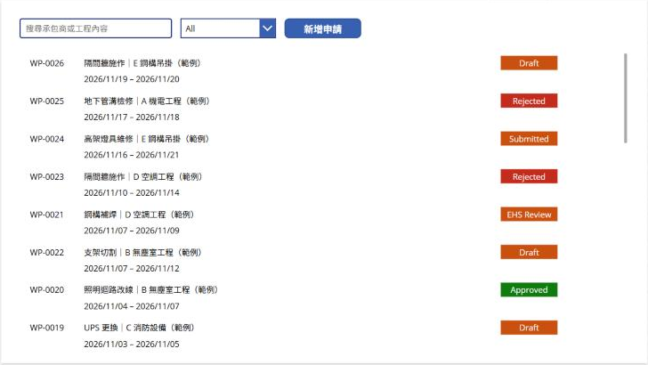
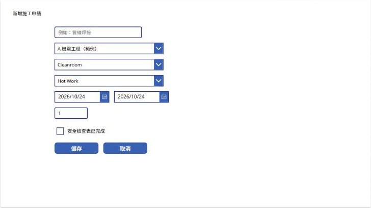
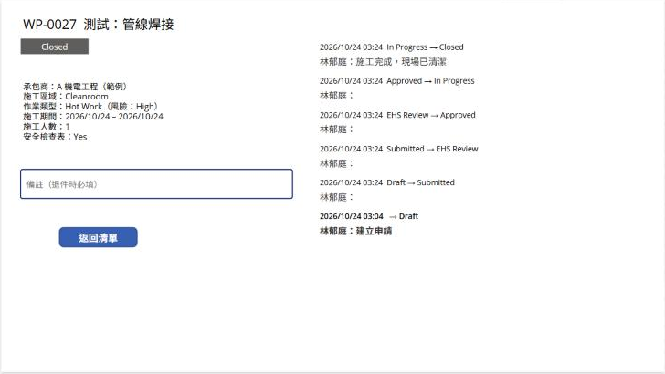
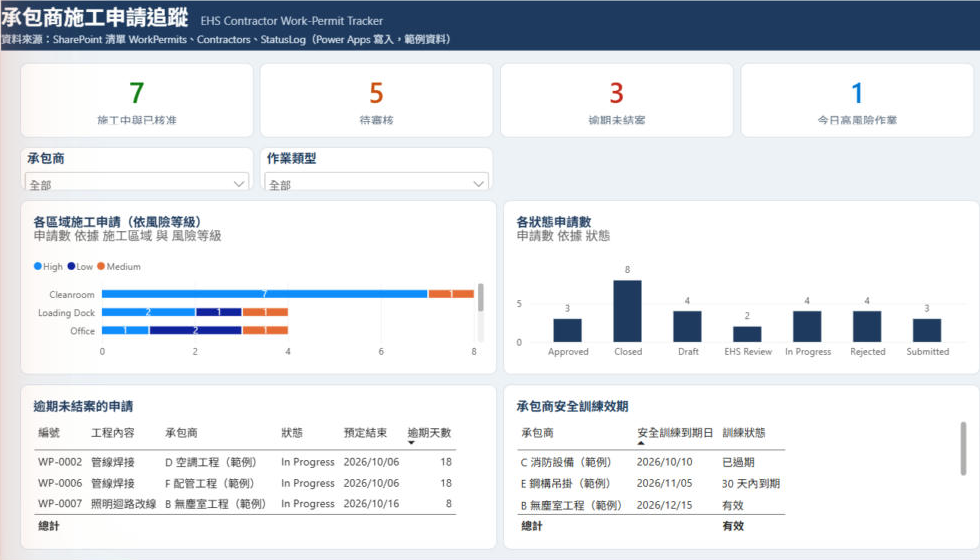
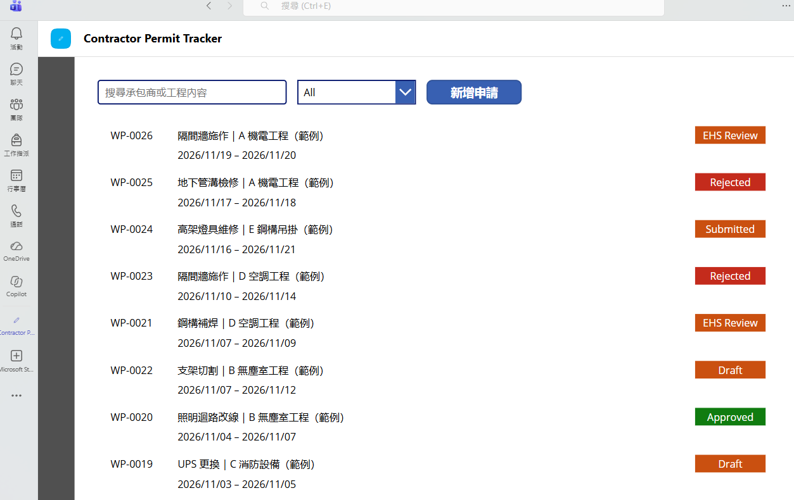
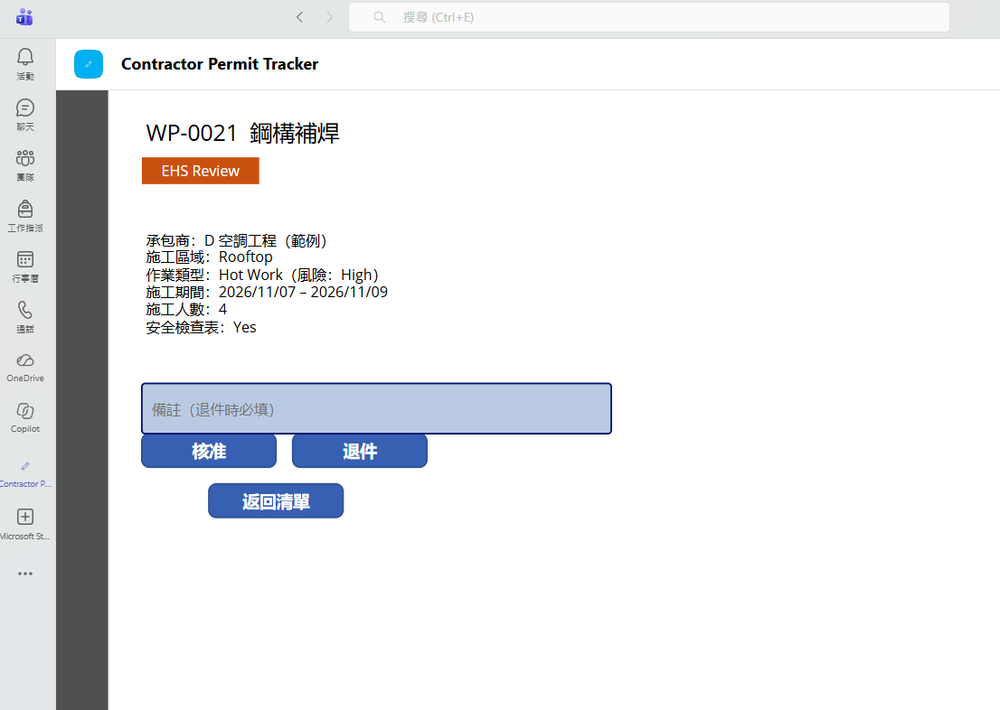

# EHS Contractor Work-Permit Tracker

A **Power Apps + SharePoint + Power BI** solution for tracking contractor construction work permits from request to close, with an audit trail of every status change and an EHS dashboard on the same data.

Built as a personal portfolio project on Microsoft 365 (university tenant). All contractors and permits are **fictional sample data**.

▶ **[Demo video (1 min)](https://youtu.be/m0PH4x4QTc8)**: one hot-work permit (WP-0031) from request through approval to close.

| Permit list | New permit form |
|---|---|
|  |  |
| **Status audit trail** | **Power BI EHS dashboard** |
|  |  |

### Running inside Microsoft Teams

| Permit list in Teams | EHS review step in Teams |
|---|---|
|  |  |

## What it does

**Power Apps canvas app** (also embedded in Microsoft Teams)

- **Permit list**: search by contractor or work, filter by status, colour-coded status badges, overdue flag.
- **Request form** with rule-based validation written in Power Fx: required fields, end date not before start date, and **hot work cannot be saved until the safety checklist is complete**. Risk level (High / Medium / Low) is derived from the work type, not chosen by the user.
- **Six-stage workflow**: Draft → Submitted → EHS Review → Approved → In Progress → Closed, plus Rejected. Approval is disabled until the safety checklist is complete; rejection requires a reason.
- **Track and trace**: every status change writes a row to `StatusLog` (from, to, comment). SharePoint records who made the change and when, and the detail screen shows the full history.

**Power BI dashboard** (PBIP project, reads the same SharePoint lists)

- KPI cards: active permits, pending review, overdue permits, high-risk work today.
- Permits by area and risk level; permits by status.
- Overdue permits ranked by days overdue; contractor safety-training expiry status.
- Power Query handles two real-world issues: SharePoint's internal column names from the Excel import (`field_1`…) and UTC-stored dates converted to Taipei time.

## Architecture

```
Power Apps canvas app (Teams tab)
        │  Patch()
        ▼
SharePoint lists ── WorkPermits ──< StatusLog   (one permit, many status changes)
                         │
                         >── Contractors        (many permits, one contractor)
        │
        ▼
Power BI semantic model (3 tables, 2 relationships, 9 DAX measures) ──► one-page dashboard
```

| List | Key columns |
|---|---|
| `Contractors` | Title, ContactPerson, Phone, SafetyTrainingExpiry, InsuranceExpiry |
| `WorkPermits` | Title, Contractor, Area, WorkType, RiskLevel, StartDate, EndDate, Workers, SafetyChecklist, Status |
| `StatusLog` | Title (permit no.), FromStatus, ToStatus, Comment, plus SharePoint's Created / Created By |

## Repository layout

| Path | Contents |
|---|---|
| `power-apps/src/*.pa.yaml` | Readable source of each screen: every control and Power Fx formula |
| `power-bi/` | Power BI project (`.pbip`): TMDL semantic model and report definition, diffable in Git |
| `data/permit_seed_data.xlsx` | Seed data used to create the SharePoint lists (6 contractors, 26 permits) |

Key formulas: the save-and-validate logic is `btnSave.OnSelect` in [`scrForm.pa.yaml`](power-apps/src/scrForm.pa.yaml); the workflow and audit log are `btnNext` / `btnReject` in [`scrDetail.pa.yaml`](power-apps/src/scrDetail.pa.yaml); the DAX measures are in [`WorkPermits.tmdl`](power-bi/EHS_Permit_Dashboard.SemanticModel/definition/tables/WorkPermits.tmdl).

## Run it yourself

1. In a SharePoint site, create the three lists: import `Contractors` and `WorkPermits` from `data/permit_seed_data.xlsx` (Lists → New list → From Excel), and create `StatusLog` as a blank list with single-line text columns `FromStatus`, `ToStatus`, `Comment`.
2. Create a blank canvas app, add the three lists as SharePoint data sources, and rebuild the screens from `power-apps/src/*.pa.yaml` (each control's properties and Power Fx formulas are listed there).
3. Open `power-bi/EHS_Permit_Dashboard.pbip` in Power BI Desktop, replace `YOUR-TENANT` / `YOUR-SITE` in the three table queries (Transform data) with your site URL, sign in with your organisational account and refresh.

## Possible extensions

- Power Automate: notify the EHS reviewer on submission and remind contractors before safety training expires.
- Move from SharePoint to Dataverse for larger volumes (delegation limits) and role-based security.
- Attach method statements and drawings to each permit.
